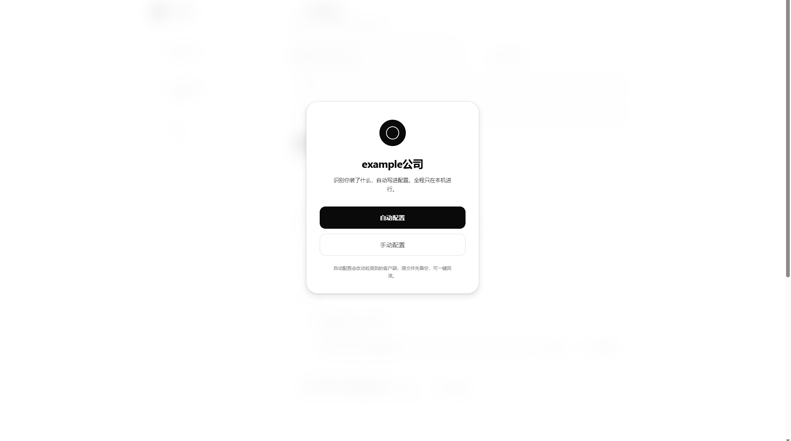
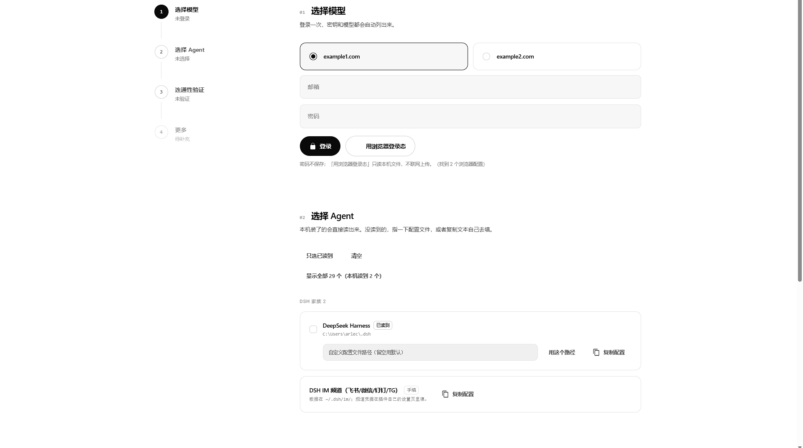
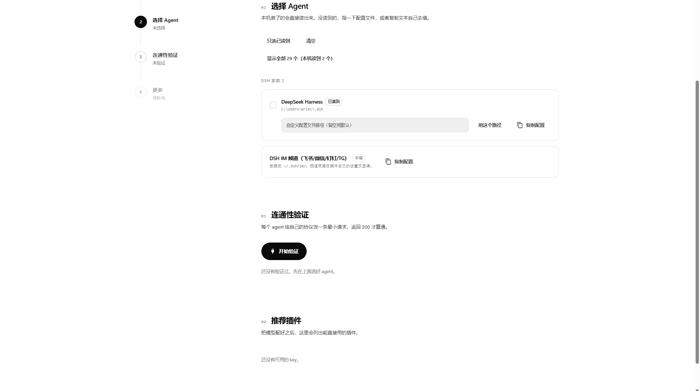

# One-Click API Config

Point every AI client on a machine at **one** OpenAI / Anthropic-compatible endpoint —
from a local web page, in one click.

> Every endpoint in this repository is a placeholder (`example1.com`, `example2.com`).
> Put your own relay in `src/core/steps.js` → `ENDPOINT_CANDIDATES`.



## Why

Configuring 30+ AI tools by hand means 30+ different file formats, and one wrong
indentation silently breaks a tool. This tool detects what is installed, writes the
smallest correct diff for each client, and keeps a backup you can roll back.

- Detects **29 clients** across CLI agents, editors, extensions, desktop apps and the
  DSH family — using seven kinds of evidence (config dirs, install dirs, npm global
  packages, VS Code extensions, extension `globalStorage`, registry `App Paths`,
  `where` / Start Menu).
- Shows the **draft diff** before touching anything; writes only after confirmation.
- Backs up every file, verifies by hash, and skips files that changed underneath.
- Runs entirely on `127.0.0.1`: no account, no telemetry, keys masked in responses.

## Screenshots

Two-step manual flow (step 1: endpoint + login, step 2: pick clients):



Client list — what was found on this machine, with the evidence path, plus a copy-ready
snippet for anything that cannot be written safely:



## Quick start

```bash
node bin/aac.js serve      # opens http://127.0.0.1:<random port>
node bin/aac.js scan       # what is installed, with evidence
node bin/aac.js plan       # dry-run diff, no writes
node bin/aac.js apply      # write files (asks for confirmation)
node --test                # 8 tests
```

## Build a single exe

```bash
node scripts/build-ci.mjs  # dist/aac.exe — Node SEA, GUI subsystem, icon + version
```

The exe carries a self-signed publisher certificate and offers to trust it on first run.
That removes the "unknown publisher" prompt on machines you control. Distributing to
strangers needs a CA certificate — see `.github/workflows/sign.yml` for the
[SignPath Foundation](https://about.signpath.io/foundation) setup used by releases.

## How it stays safe

| Risk | Mitigation |
|---|---|
| Wrong format written | Unknown formats are exported for manual copy instead of guessed |
| Clobbering user edits | `beforeHash` check, backup manifest, one-click rollback |
| Leaking keys | Masked in every API response; never uploaded |
| Remote access | Binds `127.0.0.1` only |

## Layout

```
bin/            CLI entry
src/core/       state, steps, endpoint probing, drafting, applying, client locating
src/adapters/   one adapter per client (format editors + guided exports)
src/web/        inline HTML/CSS/JS for the local UI
scripts/        build, SEA packing, PE patching, icon/version resources
```

## Code signing

Free code signing provided by [SignPath.io](https://signpath.io/), certificate by
[SignPath Foundation](https://signpath.org/). Release binaries are signed through the
workflow in `.github/workflows/sign.yml`.

## License

MIT
